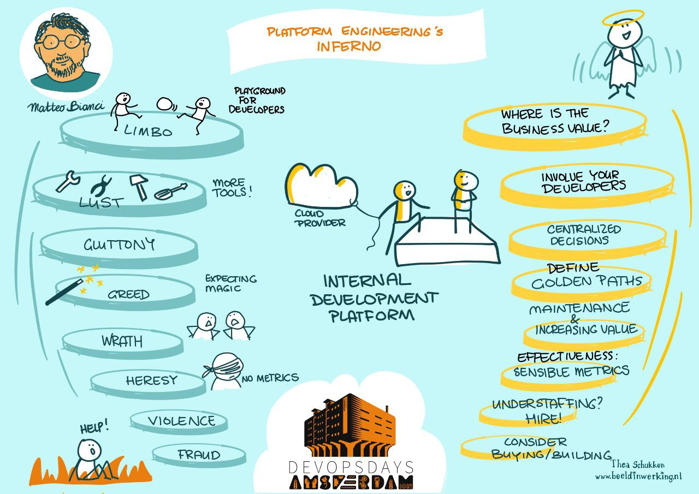

# Platform Engineering Roadmap

An opinionated, interactive learning roadmap for engineers developing platform and SRE skills, and teams building or evolving internal platforms. It covers technical foundations, certifications, organizational practices, and AI, ML, and AI agent practices for platform work.

**[Explore the live roadmap](https://platform-engineering-roadmap.mbianchi.dev/)**. No installation or account is needed to browse it.

The roadmap is inspired by [Teivah's SRE roadmap](https://github.com/teivah/sre-roadmap). In time, I created something similar to [roadmap.sh](https://roadmap.sh/) but for Platform Engineers.

## Explore the roadmap

The topic atlas groups the roadmap into **Individual Skills**, **Certifications**, and **Company Level**. Branch connections show categories, not prerequisites or a mandatory learning order.

Technical topics include [data services and recovery](https://platform-engineering-roadmap.mbianchi.dev/#topic=data-recovery), [platform testing](https://platform-engineering-roadmap.mbianchi.dev/#topic=platform-testing), [multi-tenancy and isolation](https://platform-engineering-roadmap.mbianchi.dev/#topic=multi-tenancy), and [AI workload infrastructure](https://platform-engineering-roadmap.mbianchi.dev/#topic=ai-workload-infrastructure). Company-level topics cover [FinOps and platform economics](https://platform-engineering-roadmap.mbianchi.dev/#topic=finops) and [platform lifecycle](https://platform-engineering-roadmap.mbianchi.dev/#topic=platform-lifecycle), alongside adoption, culture, and governance.

- All topics are visible by default, with no **Show more** step. Branch headers still let you collapse and expand whole groups.
- Search topic names, descriptions, key areas, and resource titles. Multiple search terms must all match the same topic.
- Open a topic to read the same descriptions, key areas, and resources in a centered dialog. The roadmap stays behind a blurred backdrop, with keyboard focus inside the dialog and background scrolling paused.
- Share the topic's URL, such as [`#topic=cloud-native`](https://platform-engineering-roadmap.mbianchi.dev/#topic=cloud-native). Browser Back and Forward preserve topic navigation. Use **Close topic**, press Escape, or click the backdrop to return to the roadmap with your search and focus restored.
- Dark mode is the default, regardless of your device's theme. Use the moon/sun button in the header to switch modes; your choice is saved in this browser. If browser storage is blocked, switching still works for the current page but cannot persist after reloading.

## Run locally

### Prerequisites

- Git, npm, and Node.js **22.13 or newer on the 22.x line**, or a supported newer LTS release. CI uses Node.js 22.
- A current desktop or mobile browser with JavaScript enabled and native HTML dialog support.

The site is a static React/Vite application. No backend, database, account, API keys, `.env` file, or external font service is required. Node.js is only needed for development and building, not for browsing the deployed site.

### First run

```bash
git clone https://github.com/mbianchidev/platform-engineering-roadmap.git
cd platform-engineering-roadmap
npm ci
npm run dev
```

Open the local URL printed by Vite, normally `http://localhost:5173`. You should see the three roadmap branches and a search field. Search for `Kubernetes` and open a topic to see its key areas and resource links.

### Development commands

| Command | Purpose |
| --- | --- |
| `npm run dev` | Start Vite's development server with live updates. |
| `npm run build` | Build the static site into `dist/`. |
| `npm run preview` | Serve an existing production build locally, normally at `http://localhost:4173`. |
| `npm test` | Run the Node.js unit tests. |
| `npm run lint` | Run ESLint. |
| `npm run test:e2e` | Build and test desktop and mobile interactions with Playwright and Chromium. |

Run `npm run build` before `npm run preview`. For browser installation, Linux system dependencies, and the E2E test server's port requirements, see the [development setup guide](CONTRIBUTING.md#development-setup).

## Content and configuration

Roadmap content lives in [`src/data/roadmapData.js`](src/data/roadmapData.js): sections, topics, descriptions, key areas, and resource links. Keep existing topic IDs stable because shared `#topic=...` URLs depend on them. Edit the source and rebuild to publish content changes; there is no browser-based content editor or remote content service.

The UI lives in [`src/components/`](src/components/), with shared theme styles in [`src/index.css`](src/index.css). Hosting configuration is described below.

## Limitations

This is a learning reference, not a learning management system or a provisioned platform. There are no accounts, completion tracking, or cross-device synchronization. The AI, ML, and agent entries are educational content, not built-in model integrations or running agents.

Search and collapsed branches are page-local state, not saved preferences. The selected topic is shareable through its URL, and the theme preference is stored only in the current browser. External learning resources are maintained by their respective publishers.

## Deployment

Run `npm run build` and publish `dist/` to a static web host. Use `npm run preview` to inspect the build locally, not as a production server.

The site is deployed to GitHub Pages from `main` by [the Pages workflow](.github/workflows/deploy.yml). Pull requests run validation without deploying. The custom domain is declared in [`public/CNAME`](public/CNAME), and [`vite.config.js`](vite.config.js) sets `base: '/'` because the site is served from the custom domain root.

For your own deployment, replace or remove `public/CNAME` as appropriate. If serving under a subpath such as `/platform-engineering-roadmap/`, update Vite's `base` to match before building. Topic navigation uses URL hashes rather than server-side routes.

## About me

I have been a Platform Engineer even before the name was out there, fighting Conway Law, dealing with team topologies (yes, before the book).

It was called DevOps Engineering before and previously Operations, but deep down we were already building the foundations of automation, pipelines, infrastructure and everything that turned out to be Platform Engineering.

Why did I build this website? Just because.



This picture is from one of my talks, at DevOpsDay Amsterdam 2024 - Platform Engineering's Inferno - you can find a video [here](https://www.youtube.com/watch?v=dWn48x4v34Q).

_Note: This repo also contains a [Platform Engineering Manifesto](platform-engineering-manifesto.md) which is playfully inspired by the Agile Manifesto._

## Contributing

I want this roadmap to be useful to the largest amount of people and if you want to help you are very welcome.

Any contribution matters, whether that's a topic suggestion, a resource, feedback, or a PR. **No vendor pitches.**

Read the [contributing guide](CONTRIBUTING.md) and [Code of Conduct](CODE_OF_CONDUCT.md) before contributing. See the [security policy](SECURITY.md) for private vulnerability reports and the [support policy](SUPPORT.md) for support expectations.

## License

Usual [MIT](LICENSE), we love that.

## Legacy roadmap

The previous README content is preserved in [LEGACY.md](LEGACY.md). New roadmap content is maintained in the interactive website's source instead.
